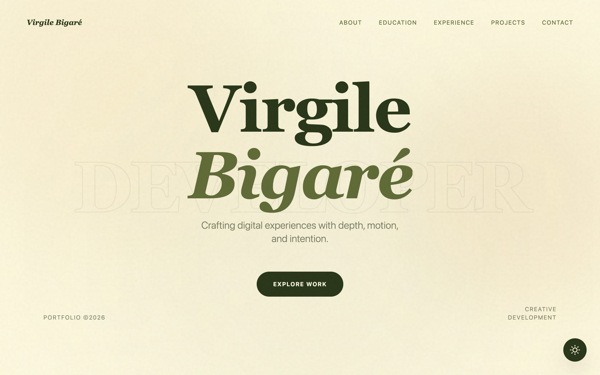
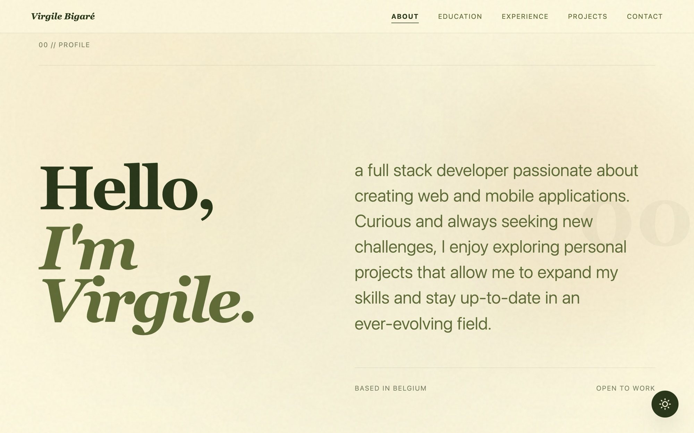
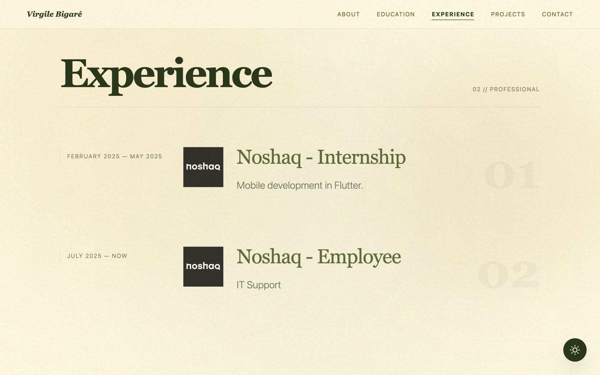
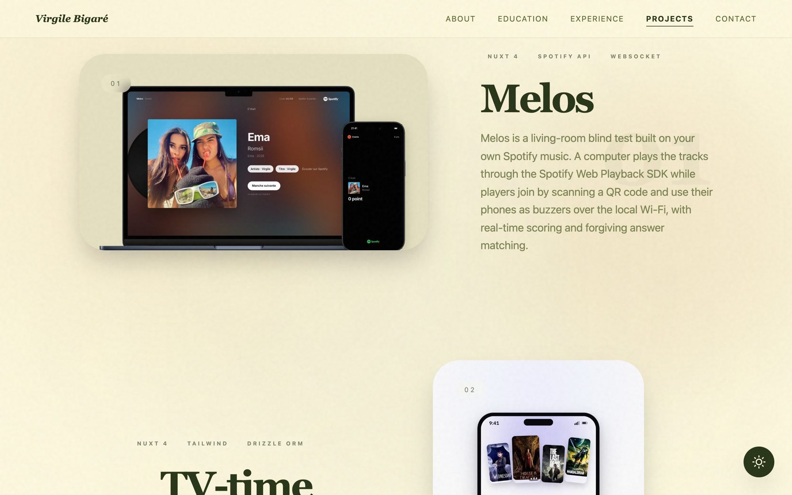
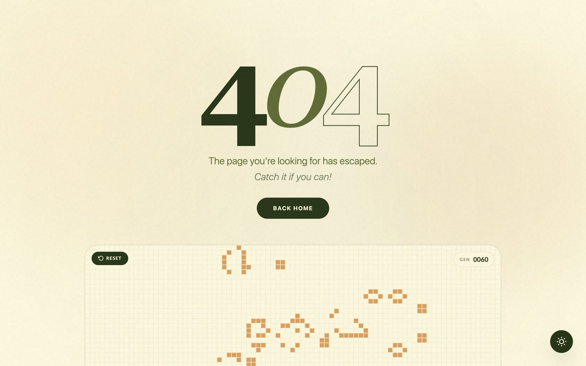
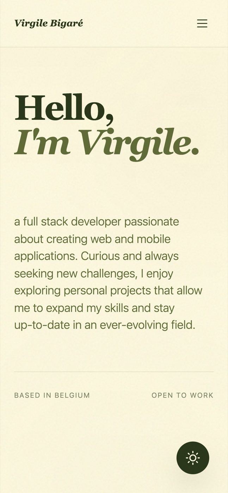
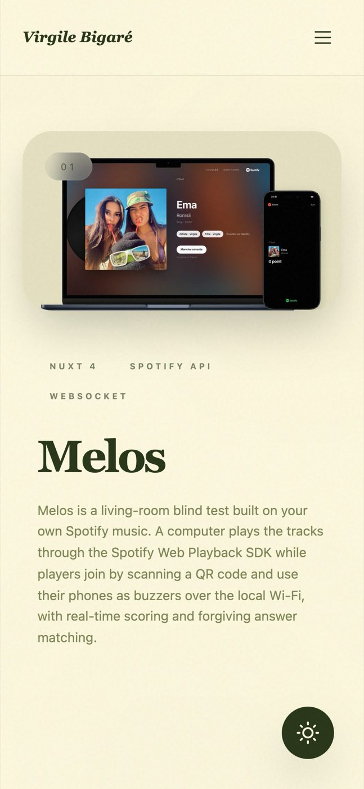

<div align="center">

<picture>
  <source media="(prefers-color-scheme: dark)" srcset=".github/readme/hero-dark.jpg">
  
</picture>

<br>
<br>

**A cinematic, editorial developer portfolio built on scroll-driven reveals.**

[virgill-e.com](https://virgill-e.com) &nbsp;·&nbsp; [LinkedIn](https://www.linkedin.com/in/virgile-bigar%C3%A9/) &nbsp;·&nbsp; [GitHub](https://github.com/virgill-e) &nbsp;·&nbsp; [X](https://x.com/virgill_e) &nbsp;·&nbsp; [Instagram](https://www.instagram.com/virgill_e/)

<br>


</div>

<br>

## 01 // Overview

This is the source of my personal site: a single page that walks through who I am, where I studied, where I work and what I build. The design treats type and motion as the main material. Oversized serif headlines, a cream and forest palette that flips to a near-black theme, and sections that reveal themselves as you scroll rather than sitting there all at once.

Screenshots below follow your GitHub theme. Switch between light and dark to see both versions of the site.

<br>

## 02 // A closer look

<table>
  <tr>
    <td>
      <picture>
        <source media="(prefers-color-scheme: dark)" srcset=".github/readme/about-dark.jpg">
        
      </picture>
      <p align="center"><sub><b>Profile</b> &nbsp;·&nbsp; masked line reveals on the headline</sub></p>
    </td>
    <td>
      <picture>
        <source media="(prefers-color-scheme: dark)" srcset=".github/readme/experience-dark.jpg">
        
      </picture>
      <p align="center"><sub><b>Experience</b> &nbsp;·&nbsp; timeline with ghost index numerals</sub></p>
    </td>
  </tr>
  <tr>
    <td>
      <picture>
        <source media="(prefers-color-scheme: dark)" srcset=".github/readme/projects-dark.jpg">
        
      </picture>
      <p align="center"><sub><b>Selected works</b> &nbsp;·&nbsp; alternating layout with parallax media</sub></p>
    </td>
    <td>
      <picture>
        <source media="(prefers-color-scheme: dark)" srcset=".github/readme/404-dark.jpg">
        
      </picture>
      <p align="center"><sub><b>404</b> &nbsp;·&nbsp; Conway's Game of Life, seeded with the digits 404</sub></p>
    </td>
  </tr>
</table>

<div align="center">
  <picture>
    <source media="(prefers-color-scheme: dark)" srcset=".github/readme/mobile-about-dark.jpg">
    
  </picture>
  &nbsp;&nbsp;
  <picture>
    <source media="(prefers-color-scheme: dark)" srcset=".github/readme/mobile-projects-dark.jpg">
    
  </picture>
  <p><sub>Same layout language on a 390&nbsp;px screen.</sub></p>
</div>

<br>

## 03 // Details worth noticing

- **Scroll as the narrative.** Every section enters through GSAP ScrollTrigger: headlines rise out of a mask line by line, project media drifts on a scrubbed parallax, and the navigation underlines the section you are reading.
- **A theme switch that feels physical.** Light and dark follow the system preference. The toggle uses the View Transitions API so the new theme spreads in a circle from the exact point you clicked.
- **A 404 worth getting lost on.** The error page runs Conway's Game of Life on a canvas, seeded with a pixel-art "404" that holds still for a moment before it starts to evolve.
- **Stable on phones.** Mobile in-app browsers (Instagram, TikTok) resize the viewport while you scroll. The viewport height is pinned in JavaScript and only updates on real width changes, so full-screen sections never jump.
- **Motion that can be turned off.** `prefers-reduced-motion` collapses every animation and transition to an instant state.
- **Clean on the server side too.** Unknown URLs return a real `404` status, the `x-powered-by` header is stripped, and the production container runs as an unprivileged user.

<br>

## 04 // Stack

| Layer | Choice |
| --- | --- |
| Framework | [Nuxt 4](https://nuxt.com) on Vue 3, Vite 8 and Nitro, rendered as a single-page app |
| Styling | [Tailwind CSS 4](https://tailwindcss.com) with theme tokens defined as CSS variables |
| Motion | [GSAP](https://gsap.com) with ScrollTrigger |
| Media | [@nuxt/image](https://image.nuxt.com), WebP mockups and an inline MP4 |
| Hosting | Node 24 Alpine container, deployed with [Dokploy](https://dokploy.com) |

<br>

## 05 // Run it locally

Requires Node.js 22.22.3+ or 24.15+.

```bash
git clone https://github.com/virgill-e/portfolio.git
cd portfolio
npm install
npm run dev
```

The dev server starts on [localhost:3000](http://localhost:3000).

To run the production build in Docker, as it is deployed:

```bash
docker build -t portfolio .
docker run -p 3001:3001 portfolio
```

<br>

## 06 // Structure

```
app/
  pages/          index.vue, the whole site in one page
  components/
    layout/       Navbar, Footer
    ui/           Hero, About, Education, Experience, Projects, GameOfLife, ThemeToggle
  plugins/        GSAP registration, mobile viewport pinning
  assets/         global CSS, project mockups
  error.vue       404 page
server/
  middleware/     visit logging
  plugins/        response header cleanup
Dockerfile        production image, runs as the node user
```

<br>

<div align="center">
  <sub>Designed and built by <a href="https://virgill-e.com">Virgile Bigaré</a> in Belgium.</sub>
</div>
